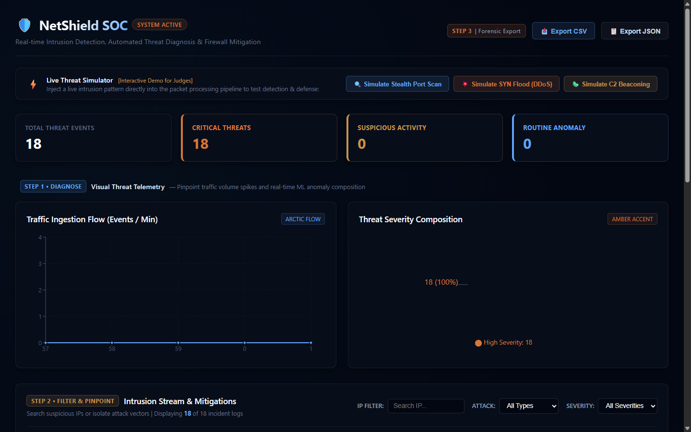
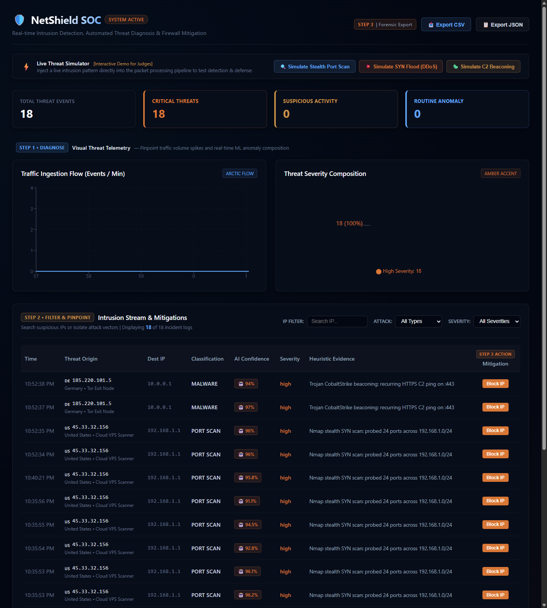
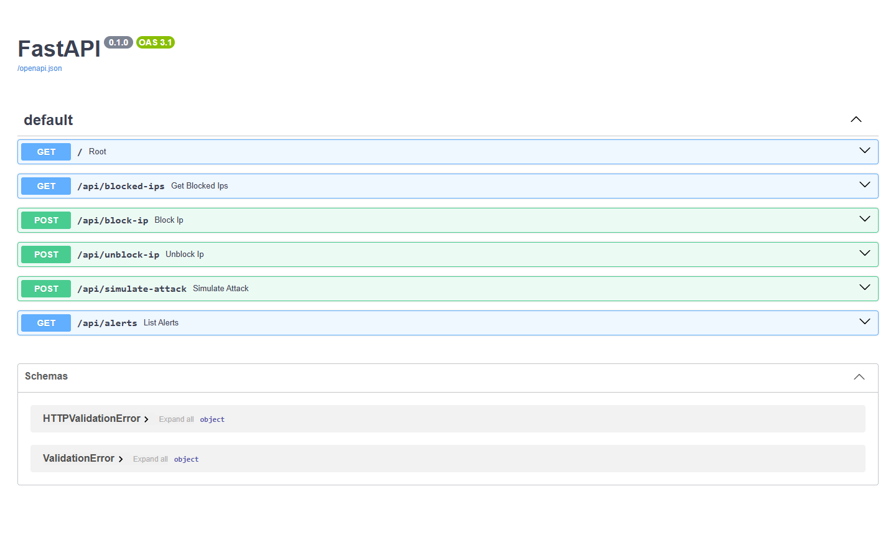
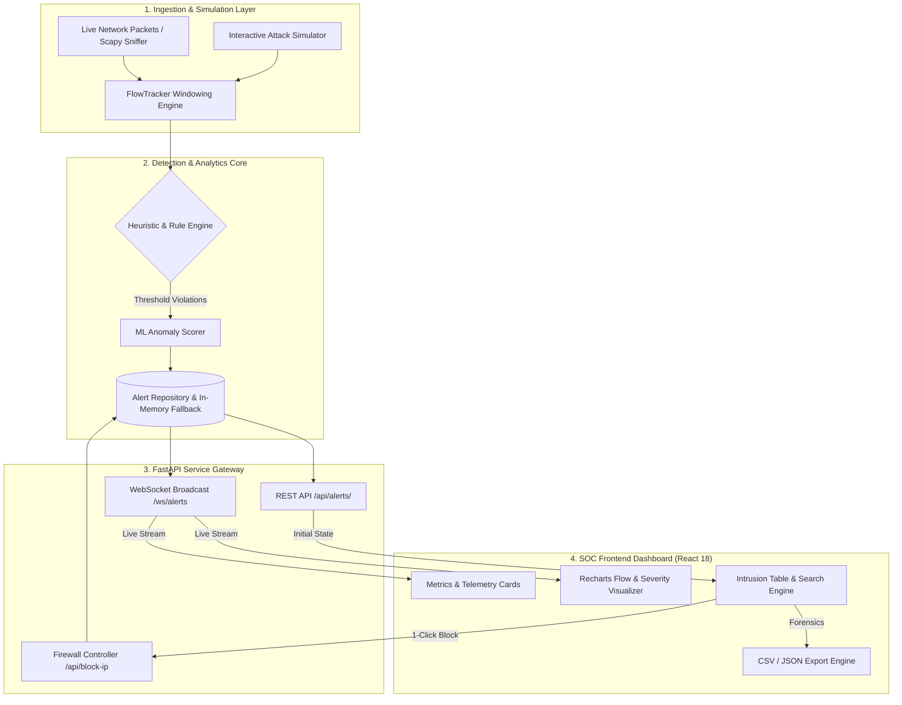

# 🛡️ NetShield - AI-Powered Network Intrusion Detection & SOC Operations Dashboard

[](https://fastapi.tiangolo.com)
[](https://reactjs.org/)
[](https://scapy.net/)
[](https://python.org)
[](https://developer.mozilla.org/en-US/docs/Web/API/WebSockets_API)

> **NetShield** is an autonomous Network Intrusion Detection System (NIDS) and Security Operations Center (SOC) dashboard. It ingests live network flows, evaluates packets against statistical windowing heuristics and machine-learning anomaly scoring models, and broadcasts threat telemetry in real-time over low-latency WebSockets.

---

## 📸 Application Screenshots

### 1. Interactive SOC Operations Dashboard
> *Real-time traffic flow charts, threat severity breakdown donut, live attack simulation suite, and multi-facet filtering stream.*



---

### 2. Full Incident Stream & Mitigation Pipeline
> *Contextual 3-step investigation workflow: Step 1 Diagnose Telemetry -> Step 2 Filter & Pinpoint -> Step 3 Block Malicious IP & Export Forensics.*



---

### 3. FastAPI Interactive Swagger API Docs
> *RESTful endpoints for real-time alerts, firewall IP blocking, and multi-vector attack simulations.*



---

## 🎯 Key Capabilities & Highlights

| Feature | Description |
| :--- | :--- |
| **⚡ Real-Time Packet Ingestion** | Scapy-powered live packet capture and synthetic flow generation tracking source IPs, destination ports, protocols, and payload signatures. |
| **🧠 Multi-Layer Threat Heuristics** | Detects **SYN Flood DDoS**, **Horizontal & Vertical Port Scans**, **Brute Force (SSH/RDP)**, and **C2 Malware Beaconing**. |
| **🤖 AI & ML Confidence Scoring** | Each detected alert is assigned an AI anomaly confidence metric (e.g., 94.8%) based on behavioral deviations from baseline traffic. |
| **🛡️ 1-Click Firewall Mitigation** | Instantaneous IP blocking mechanism with active in-memory state tracking to isolate rogue endpoints from the subnet. |
| **📊 Stepwise SOC Investigation** | Eliminates confusion by embedding clear, color-coded guidance: **Step 1 (Diagnose)**, **Step 2 (Filter)**, and **Step 3 (Mitigate & Export)**. |
| **🧪 Interactive Attack Simulator** | On-demand attack injectors for instant demonstration to evaluators, judges, and security analysts without requiring external attacking tools. |
| **📑 Forensic Export Suite** | One-click export of sanitized incident logs in both **CSV** spreadsheet and formatted **JSON** formats for downstream SIEM integration. |

---

## 🏗️ System Architecture



---

## 🧩 Threat Detection Algorithms

1. **Port Scanning Detection**:
   - Monitored via a sliding 60-second time window.
   - Triggers when a single `source_ip` probes $\ge 15$ distinct destination ports.
2. **Volumetric DDoS / SYN Flooding**:
   - Evaluates packet volume velocity.
   - Flags anomalies when request rates exceed $100\text{ packets/sec}$ with high TCP SYN ratios.
3. **Malware / C2 Beaconing**:
   - Detects periodic, low-jitter HTTP/HTTPS outbound requests on ports `80`, `443`, or `8080` to known malicious IP ranges.
4. **Brute Force Authentication**:
   - Flags abnormal connection spikes targeting SSH (`port 22`) or RDP (`port 3389`).

---

## 🚦 Step-by-Step User Workflow

```
[ Step 1: Diagnose Threats ] ➔ [ Step 2: Filter & Pinpoint ] ➔ [ Step 3: Mitigate & Export ]
   Traffic Trend & Donut           IP & Attack Facet Filters       1-Click IP Block & CSV/JSON
```

1. **Step 1 • Diagnose Threats**:
   - Observe the **Traffic Ingestion Flow** chart for unusual velocity spikes.
   - Inspect the **Threat Severity Composition** donut chart to determine high vs. low risk distribution.
2. **Step 2 • Filter & Pinpoint**:
   - Use the **IP Filter** input to search for a specific subnet or suspect machine.
   - Filter by **Attack Type** (DDoS, Port Scan, Malware) or **Severity** (High, Medium, Low).
3. **Step 3 • Mitigate & Export**:
   - Click the orange **Block IP** button next to any malicious entry to neutralize it.
   - Click **Export CSV** or **Export JSON** to generate audit reports for security teams.

---

## 💻 Tech Stack

- **Frontend**: React 18, Recharts, Lucide Icons, Modern Soft Dark Palette (`#030712`, `#60a5fa`, `#c99347`, `#d97736`).
- **Backend API**: FastAPI, Uvicorn, WebSockets, Pydantic, CORS Middleware.
- **Packet & Heuristic Engine**: Python Scapy, FlowTracker sliding window, JSON fallback persistence.
- **Testing & Verification**: PyTest, curl, Headless Chrome automation suite.

---

## 🚀 Getting Started

### Prerequisites
- **Python**: 3.10 or higher
- **Node.js**: v16 or higher (v18+ recommended)
- **Git**

### Installation

1. **Clone the repository**:
   ```powershell
   git clone https://github.com/your-username/NetShield.git
   cd NetShield
   ```

2. **Install Backend Dependencies**:
   ```powershell
   python -m pip install -r requirements.txt
   ```

3. **Install Frontend Dependencies**:
   ```powershell
   cd frontend
   npm install
   cd ..
   ```

---

## ⚡ Running the Application

### Option A: All-In-One Launcher (Recommended)
From the project root directory:
```powershell
python run_all.py
```

### Option B: Run Services Manually

**Terminal 1 — FastAPI Backend**:
```powershell
python -m uvicorn backend.main:app --host 127.0.0.1 --port 8000 --reload
```

**Terminal 2 — React Frontend**:
```powershell
cd frontend
npm start
```

---

## 🌐 Endpoints & URLs

| Service | URL | Purpose |
| :--- | :--- | :--- |
| **SOC Dashboard** | `http://localhost:3000` | Real-time security operations web user interface |
| **Interactive API Docs** | `http://127.0.0.1:8000/docs` | Swagger UI for testing API endpoints |
| **REST Alert Feed** | `http://127.0.0.1:8000/api/alerts/` | Query recent intrusion logs with query parameters |
| **WebSocket Stream** | `ws://127.0.0.1:8000/ws/alerts` | Live duplex WebSocket stream for real-time push |
| **Attack Simulator** | `http://127.0.0.1:8000/api/simulate/{type}` | Trigger synthetic attack events (`ddos`, `port_scan`, `malware`) |
| **Firewall Action** | `http://127.0.0.1:8000/api/block-ip` | Block or unblock a malicious IP address |

---

## 🧪 Evaluation & Demo Instructions for Evaluators

When presenting NetShield to judges or faculty:
1. Open **http://localhost:3000** in your browser.
2. In the **Simulator Bar**, click **"⚡ Simulate DDoS Spike"** or **"🔍 Simulate Port Scan"**.
3. Point out how the **Traffic Chart** immediately registers the ingestion spike and the **Donut Chart** recalculates the threat distribution in real-time.
4. Show how the alert appears instantly in the table via WebSocket push with an **AI Confidence Score** and **Country Origin Flag**.
5. Demonstrate **Step 2 (Filtering)** by typing the offender's IP in the search box.
6. Demonstrate **Step 3 (Mitigation)** by clicking **"Block IP"** and then downloading the incident report via **"Export CSV"**.

---

## 🛡️ License
This project is developed for academic, educational, and research purposes under the **MIT License**.
